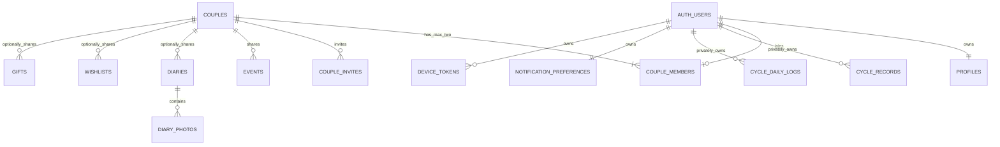

# 아키텍처와 개인정보 설계 초안

> **2026-10-28 변경:** 사용자의 최신 요청으로 건강 기록은 커플 공유 데이터이며, 같은 커플 구성원은 작성자와 관계없이 조회·수정·삭제합니다. 아래 개인 전용 건강 정책은 과거 설계입니다. 현재 구현은 `apps/mobile/README.md` 및 `20261027000100_shared_health.sql`을 기준으로 합니다.

2026-10-26. 설계만 작성했으며 Supabase 프로젝트·테이블·회원·Storage·RPC를 생성하지 않았다.

## 구성과 신뢰 경계

React Native + Expo + TypeScript + Expo Router → Supabase Auth → 사용자 JWT로 PostgreSQL RLS/비공개 Storage 접근. Realtime은 공유 일정 변경을 알려 주고 앱이 권한을 다시 확인해 재조회한다. 별도 상시 API 서버 없이 초대/탈퇴 등 원자적 작업은 DB RPC, 외부 공휴일 데이터 캐시 갱신은 필요 시 Edge Function을 사용한다.

앱은 공유 허용 목록에서 위젯 스냅샷을 만들어 단말에 전달한다. 위젯에는 토큰, 건강 기록, 일기 본문, 사진, 초대 코드가 들어가지 않는다. 알림 내용은 기본적으로 일반 문구다. 민감 알림은 로컬에서만 예약하며 서버 푸시에 건강 내용을 담지 않는다. 앱 잠금은 로컬 보호이며 Auth와 RLS를 대체하지 않는다. 백그라운드 전환 시 민감 화면을 가리고 앱 전환기 미리보기도 검증한다.

## ERD 초안

## 데이터 형태

공통 PK는 UUID, 생성·수정 시각은 `timestamptz`, 충돌 제어 `version`을 둔다. 달력 날짜는 `date`이며 UTC 변환으로 전날이 되지 않게 한다.

| 테이블 | 핵심 컬럼·제약 |
|---|---|
| profiles | user_id PK→auth.users, private_name; 파트너에게 직접 공개하지 않음 |
| couples | id, relationship_start date, agreed_display_names jsonb(허용 키만); 합의된 표시 데이터만 저장 |
| couple_members | couple_id FK, user_id UNIQUE, slot CHECK IN (1,2), UNIQUE(couple_id,slot); MVP 탈퇴 시 행 삭제·감사는 별도 비공개 로그 |
| couple_invites | id, couple_id, token_hash UNIQUE, expires_at timestamptz, consumed_at, revoked_at, created_by; 원문 토큰 저장 금지 |
| events | id, couple_id, created_by, title, event_date date, optional starts_at/ends_at timestamptz, timezone; all_day와 시간 컬럼 일관성 CHECK; annual_rule/음력 month·day·is_leap 구분 |
| diaries | id, owner_id, couple_id nullable, visibility private/couple 기본 private, diary_date date, title, place, body |
| diary_photos | id, diary_id, uploader_id, storage_path UNIQUE, order_index; 접근은 부모 일기 권한 상속 |
| wishlists | id, owner_id, couple_id nullable, visibility 기본 private, title, status |
| gifts | id, owner_id, couple_id nullable, visibility 기본 private, title, memo, target_date date nullable |
| cycle_records | id, owner_id, start_date date, end_date date nullable, end>=start; 본인 기간 중복·동시 미종료 기록 방지 |
| cycle_daily_logs | id, owner_id, log_date date, symptoms 배열(허용 값), mood enum, memo varchar(300), UNIQUE(owner_id,log_date) |
| notification_preferences | user_id PK, enabled categories, advance_days 배열(범위 검증), local_time time, timezone 기본 Asia/Seoul, health_notifications 기본 false, private_overlay 기본 false, widget categories 허용 목록 |
| device_tokens | id, user_id, install_id, provider, token, platform, refreshed_at; UNIQUE(provider,token), 기기별 로그아웃 폐기 |

건강 예측은 본인 기록에서 계산한 파생값이며 공유 테이블에 복제하지 않는다. 알고리즘 버전·기준 데이터 범위를 기록하고 자료 부족 시 예측을 숨긴다. 의료 진단이나 피임 수단으로 제공하지 않는다. 건강 공유 Opt-in UI나 권한은 MVP에 만들지 않는다. 후속 추가 시 항목·수신자·유효기간·철회를 관리하는 별도 동의 모델을 먼저 설계한다.

## 권한 매트릭스

A=작성/소유자, B=같은 커플의 다른 구성원, C=제3자. 아래 권한 이외에는 거부. 익명은 모든 개인/공유 테이블 접근 불가.

| 테이블 | 조회 | 생성 | 수정 | 삭제 |
|---|---|---|---|---|
| profiles | 본인 | 본인/Auth 동기화 | 본인 허용 컬럼 | 본인 계정삭제 RPC |
| couples | 현재 구성원 A/B | create_couple RPC | 구성원, 허용 표시/시작일만 | 종료 RPC |
| couple_members | 본인 커플 구성원 | 수락 RPC만 | 직접 금지 | 탈퇴 RPC만 |
| couple_invites | 발급자에게 상태만 RPC; hash 노출 금지 | 현재 구성원 발급 RPC | 수락/폐기 RPC | 정리 RPC |
| events | 현재 A/B | 현재 구성원, created_by=auth.uid | A/B 콘텐츠만 | A/B |
| diaries | A 또는 공유된 행의 현재 B | A, 본인 커플만 | A만 | A만 |
| diary_photos | 부모 일기 조회 가능자 | 일기 소유자 | 일기 소유자 | 일기 소유자 |
| wishlists | A 또는 공유된 행의 현재 B | A | A | A |
| gifts | A 또는 공유된 행의 현재 B | A | A | A |
| cycle_records | A만 | A | A | A |
| cycle_daily_logs | A만 | A | A | A |
| notification_preferences | 본인 | 본인 | 본인 | 본인 |
| device_tokens | 본인 | 본인 | 본인 | 본인/만료 정리 서버 |

일기 등은 상대의 원문을 임의 변경하지 않도록 소유자 편집으로 시작한다. 공동 편집 필요 시 별도 결정한다. 공유 철회는 A만 가능하다. C는 couple_id/UUID를 알아도 조회/수정/사진 다운로드 전부 거부된다.

## RLS·Grants 구현 방향 (미실행)

모든 노출 테이블에 RLS를 켠다. `anon`의 테이블 권한을 제거하고 `authenticated`에 필요한 DML/컬럼만 부여한다. 단순한 RLS만으로 owner_id/couple_id를 자유 변경할 수 없게 불변 컬럼은 UPDATE grant에서 제외하거나 트리거로 차단한다. UPDATE는 기존 행 `USING`과 변경 후 행 `WITH CHECK`를 모두 검증한다.

- 개인 건강 정책: SELECT/DELETE `owner_id = (select auth.uid())`; INSERT `WITH CHECK`도 동일; UPDATE 양쪽 조건 동일. 커플 멤버십 OR 조건을 절대로 추가하지 않는다.
- 공유 정책: `private.is_current_member(couple_id)`는 입력 couple_id와 **auth.uid()**를 함께 검사한다. JWT의 임의 메타데이터나 클라이언트 전달 사용자 ID를 신뢰하지 않는다. SECURITY DEFINER가 필요하면 private 스키마, 고정 search_path='', 완전 수식 테이블명, 최소 소유권, PUBLIC EXECUTE 제거로 범위를 제한한다. 멤버 테이블 자체 정책의 재귀를 피한다.
- 일기/선물/위시 조회: 본인 OR `(visibility='couple' AND 현재 멤버)`; 생성 시 owner 일치와 유효한 couple_id를 함께 검사. 공유 변경 시에도 검사한다.
- views는 security_invoker로 만들고 건강 테이블과 공유 집계 뷰를 조인하지 않는다. RPC 결과, Realtime payload, 오류·분석 로그까지 같은 경계를 적용한다. 건강 테이블은 초기 Realtime publication에서 제외한다.
- secret/service_role 키는 앱·번들·EXPO_PUBLIC_*·위젯에 넣지 않는다. 서버의 관리자 키는 RLS를 우회하므로 서버 작업에도 호출자 검증이 필요하다.

[Supabase RLS](https://supabase.com/docs/guides/database/postgres/row-level-security)와 [Storage 정책](https://supabase.com/docs/guides/storage/security/access-control)을 기준으로 구현 전 실제 정책 테스트를 작성한다.

## 초대 수락과 정원

RPC 내부 단일 트랜잭션: auth.uid 확인 → 초대 hash 조회 → couple 행과 invite 행 잠금 → 만료/폐기/사용 여부·발급 권한 재검증 → 본인의 기존 가입 검사 → 2개 slot 중 빈자리 INSERT → 초대 소비 표시 → commit. user_id UNIQUE와 (couple_id,slot) UNIQUE로 서로 다른 초대/커플 동시 수락에도 DB에서 제한한다. 재시도는 같은 사용자에 한해 멱등 처리한다. 임의 user_id를 받지 않는다. 초대 코드는 충분한 난수·짧은 TTL·시도 제한을 적용하고 로그에 남기지 않는다. 커플 생성/탈퇴도 같은 잠금 규약을 사용한다.

## 사진·로컬 데이터·철회

사진 버킷은 private. 경로의 couple_id만 검사하지 않고 diary_photos→diaries→현재 소유/공유 정책을 검사한다. 업로드는 소유자 전용 사전 메타데이터 예약 후 동일 경로만 허용하고 미완료 업로드를 정리한다. MIME·크기 제한, EXIF 위치 제거, 무작위 경로를 사용한다. URL은 짧은 만료의 signed URL 또는 인증 다운로드다. signed URL은 만료 전 철회가 완전하지 않으므로 즉시 철회가 중요한 경우 인증 다운로드만 사용한다.

로그아웃/커플 해제 시 Auth 세션, 사진 캐시, 로컬 알림, 위젯 스냅샷을 제거한다. 오프라인 상대 단말의 이미 받은 정보는 즉시 회수할 수 없다는 한계가 있다. 위젯에는 생성 시각·유효기간을 두고 오래된 스냅샷을 민감하지 않은 상태로 바꾸는 정책을 추가한다. DB RLS는 종단간 암호화가 아니며 운영자는 별도 신뢰 경계다. 건강 데이터 서버 보관 여부는 다음 단계에서 결정한다.

## 접근 거부 검증 계획 (실행 전)

운영 데이터 대신 별도 로컬/개발 DB의 가상 A/B/C와 익명 JWT로 테스트한다. 관리자 세션으로 통과하는 테스트는 인정하지 않는다.

1. A/B 같은 커플, C 다른 커플: C가 알려진 couple_id로 각 공유 테이블 SELECT/INSERT/UPDATE/DELETE → 빈 결과 또는 권한 오류, 실제 데이터 변화 없음.
2. A 건강 기록에 B/C가 id·owner_id를 바꿔 읽기/쓰기·upsert·RPC·Realtime 시도 → 전부 거부. A의 정상 CRUD는 통과.
3. A 개인 일기·사진은 B 거부 → 공유 후 B 읽기만 가능 → 공유 철회·탈퇴 후 재요청 거부. signed URL 만료와 디스크 캐시는 별도 검증.
4. owner_id/couple_id 위조, UPDATE로 다른 커플 이동, photos 부모 바꾸기, 토큰 타인 소유 변경 → 실패.
5. 마지막 한 자리 동시 초대 수락, 한 사용자 두 커플 동시 수락, 만료/재사용/폐기 코드 → 최대 정원 2·가입 1 유지, 실패 트랜잭션 롤백.
6. 로그아웃 후 기기 토큰과 위젯·예약 알림 삭제, 재설치/다른 계정 로그인 시 이전 건강 내용 미노출.

## 날짜·공휴일·알림

`Asia/Seoul` 달력 날짜를 기준으로 D+=오늘−시작일+1; 시작 당일 1, 100일 날짜는 시작일+99. 미래 D-=대상−오늘, 당일 D-DAY, 과거 표시는 별도 D+ 또는 목록 제외. 날짜 전용 값은 일련의 civil day로 계산한다. 사용자의 해외 이동으로 관계 일수가 바뀌지 않게 서울 기준을 명시한다. 미래 시작일은 MVP 입력에서 거부한다.

매년 양력 반복은 월/일 규칙으로 다음 발생일을 산출하고 2/29는 비윤년 건너뛰기를 기본 제안한다. 음력 반복에는 윤달 여부와 윤달 없는 해의 건너뛰기 정책을 반드시 저장한다. 한국 공휴일과 상업적 커플 이벤트는 서로 다른 분류다.

[한국천문연구원 음양력 정보](https://www.data.go.kr/data/15012679/openapi.do)는 음양력·윤달 변환 조회가 확인됐다. [특일 정보](https://www.data.go.kr/data/15012690/openapi.do)는 공식 데이터 후보이나 이번 페이지 조회가 timeout으로 완료되지 않아 응답 스키마·최신 운영 상태는 재확인 필요하다. 운영 전 승인 키로 대체공휴일·임시공휴일·윤달·연말 범위를 공식 달력과 교차검증한다. 개인 날짜를 외부 API로 직접 보내지 않고 연도 단위 공용 캐시를 서버에서 받아 변환한다. 키는 Edge Function 비밀값에 두며 데이터 출처·조회시각·버전을 저장한다. 응답 실패 시 캐시 기준일/미확인을 표시하고 날짜를 임의 생성하지 않는다. PoC의 3개 일정은 공휴일이 아닌 가상 약속이다.

알림은 개인 local_time+timezone과 사전 일수에서 UTC 발송 시각을 산출한다. 일정 변경 시 취소/재예약, `(event occurrence,user,device,offset)` 중복 방지. 건강 알림은 본인 로컬 기본 비활성, 제목도 일반 문구. 위젯 자정 갱신은 OS 제한이 있어 아래 PoC 보고서와 분리해서 완료 판정한다.
