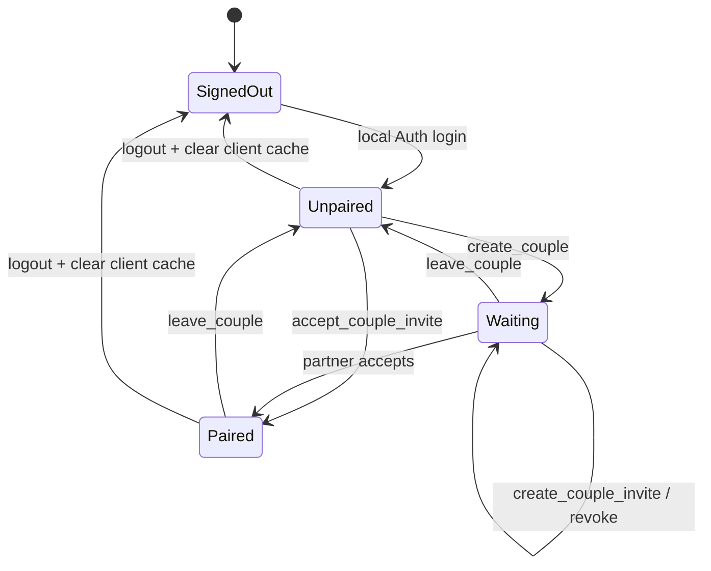

# 다음 플로우: 로컬 인증·커플 연결 구현 결과

2026-10-26. 사용자의 '이어서 다음 플로우' 요청에 따라 이전 로드맵의 **가상 사용자 기반 인증·커플 연결 및 접근 거부 검증**을 진행했다. 범위는 독립 `spikes/auth-couple-poc/`의 로컬 Supabase와 테스트다. 운영 DB, 실사용자, 건강 기록, 사진, 앱 전체, 배포는 구현하지 않았다.

## 확인한 결과

- Supabase CLI 2.122.0 / PostgreSQL 17.11.0.006 / 기존 Docker Engine 28.0.4로 로컬 Auth·PostgREST·DB·gateway 실행.
- 실제 이메일/비밀번호 Auth 로그인·refresh·로그아웃을 로컬 가상 계정으로 확인했다. 외부 이메일은 보내지 않았다.
- profiles, couples, couple_members, couple_invites 4개 테이블과 RLS·명시적 grants, 6개 공개 RPC를 구현했다.
- 테스트는 정상 권한과 거부 경로, 마지막 자리 경합, 한 사용자의 두 커플 경합을 실제 HTTP 요청으로 검사했다. DB 관리자 키로 권한 테스트를 통과시키지 않았다.
- 모바일 로그인·초대 입력 UI는 아직 없다. 건강 기록 접근 제어도 이번 실행 대상이 아니므로 검증 완료라고 하지 않는다.

## 인증·연결 흐름과 앱 연결 계약

로그아웃은 커플 탈퇴가 아니다. 앱 재로그인 시 현재 membership을 다시 조회해야 한다. 탈퇴한 사람이 이전 JWT를 갖고 있어도 RLS가 현재 membership을 확인하므로 커플 정보 조회는 즉시 차단된다. 이미 내려받은 데이터·위젯은 향후 클라이언트에서 별도로 지워야 한다.

| RPC | 입력 | 결과 | 검증 |
|---|---|---|---|
| create_couple | p_relationship_start: YYYY-MM-DD | couple UUID | 인증 필수, 미래 날짜 거부, 기존 가입 거부 |
| create_couple_invite | 없음 | invite_id, invite_token, expires_at 배열 1행 | 정원 확인, 256bit 난수, hash만 저장, 24시간 만료, 시간당 발급 5회, 이전 활성 코드 철회 |
| accept_couple_invite | p_token: 64자 hex | couple UUID | 자기 초대/만료/폐기/재사용 거부, 본인 동일 성공 재시도만 멱등 |
| revoke_couple_invite | p_invite_id: UUID | void | 현재 구성원·본인 발급 코드만 철회; 타인 ID 존재 여부 비공개 |
| set_relationship_start | p_relationship_start | void | 본인 현재 커플만, 날짜 검증 |
| leave_couple | 없음 | void | 본인 membership 제거, 코드 철회, 마지막 구성원이면 빈 커플 삭제 |

Auth는 Supabase의 표준 signup/login/refresh/logout API를 사용한다. 앱에 관리자 키를 넣을 이유가 없다. 사용자 ID를 인자로 받아 가장하는 RPC는 없다. 공개 profile 이름은 아직 합의 모델을 구현하지 않아 private_name만 저장하며 파트너에게 노출하지 않는다.

## 동시성과 접근 통제

가입 변경 RPC의 잠금 순서는 **본인 auth.users 행 → couple 행 → invite 행**이다. 한 사용자가 서로 다른 커플에 동시에 가입하는 경합도 사용자 행 잠금과 user_id PK로 직렬화된다. 정원은 slot 1/2 CHECK + (couple_id,slot) UNIQUE로 DB에서 제한한다. 새 코드 발급과 수락/탈퇴도 같은 couple 잠금을 공유한다.

couples/members는 현재 구성원만 조회한다. 멤버 직접 생성·수정·삭제는 grant하지 않으며 RPC로만 변경한다. profiles는 본인만 조회·이름 수정한다. invites는 클라이언트 table grant가 없어 hash 조회가 불가능하다. 정책 helper는 노출하지 않는 private 스키마의 SECURITY DEFINER이며 search_path는 빈 값, 참조는 완전 수식 이름, PUBLIC EXECUTE는 제거했다. RPC는 SELECT auth.uid() 기준으로 권한을 확인한다.

## 실행과 검증 결과

최종 재현 명령은 해당 폴더에서 `npm start`, `npm test`, `npm run lint:db`, `npm run stop`이다. 최초 `supabase init`, 로컬 스택 시작 시 migration 자동 적용, `npm install`을 수행했다. 원격 프로젝트 link/push는 하지 않았다.

| 검사 | 실제 결과 |
|---|---|
| npm install | 성공, 이 독립 폴더 의존성 취약점 0건 |
| 최초 Docker 접근 | 제한 환경 소켓 권한 실패 → 승인된 재시도; daemon 미실행 확인 후 Docker 실행 |
| 초기 Supabase 시작 | Docker 자격증명 도우미 대기 → 해당 시작 작업 중지, 공개 이미지용 빈 별도 설정으로 해결 |
| DB migration | 로컬 DB에 적용 성공 |
| Auth·권한 통합 검사 | **12/12 통과** (부모 테스트 1 + 상세 시나리오 11) |
| DB lint | **No schema errors found** |
| JavaScript 문법 검사 | tests와 local runner의 `node --check` 통과 |
| 네트워크 범위 | 기본 시작은 0.0.0.0 바인딩이어서 중지 후 전용 network로 변경; 최종 **127.0.0.1:55431/55432** 확인 |
| 운영 환경/실기기/UI | 미실행 |

검증 시나리오: 정상 로그인·잘못된 비밀번호·refresh·프로필 격리, 익명·변조 JWT 거부, 커플 생성·초대·멱등 수락, C의 UUID 기반 조회/쓰기/직접 멤버 변경 거부, B 탈퇴 후 접근·코드 재사용 거부, 폐기/만료/잘못된 코드 거부, 서로 다른 두 사용자 정원 경합, 같은 사용자 두 커플 경합, 초대 교체/발급 속도 제한, 마지막 구성원 탈퇴, 로그아웃 후 refresh 거부.

만료 시나리오를 만들 때와 테스트 계정을 정리할 때만 로컬 관리자 SQL을 사용한다. 나머지는 실제 사용자 JWT 또는 익명/위조 토큰으로 실행한다. 임의 sleep으로 동시성을 가장하지 않고 두 HTTP 요청을 함께 보낸다. 다만 높은 부하·장시간 경합 테스트는 범위 밖이다.

## 개인정보와 남은 제한

- 테스트 이메일은 무작위 `@example.test`; 비밀번호·JWT·초대 원문은 결과 로그에 출력하지 않는다. CLI 시작 출력에 포함될 수 있는 로컬 관리자 키도 runner에서 제거한다.
- 로컬 Auth는 이메일 확인을 생략하는 개발 설정이며 운영에 복사하지 않는다. 운영 가입/이메일 인증·비밀번호 복구·계정 삭제·MFA·초대 수락 시 상대 확인 화면은 후속 설계 대상이다.
- 초대는 256bit bearer 코드다. 코드를 받은 사람이 수락할 수 있으며, 발급 횟수 제한은 있지만 실패한 수락 시도의 사용자별 누적 제한은 아직 없다. 운영 전 abuse rate limit과 상대 확인 UI를 추가한다.
- 로그아웃으로 refresh 세션은 폐기되지만 이미 발급된 access JWT는 만료까지 유효할 수 있다. 앱은 토큰·캐시·위젯을 즉시 비우고, 민감한 서버 작업에 추가 session 검증이 필요한지 결정해야 한다.
- 파트너와 합의한 이름·공유 필드, 이벤트/건강 RLS, Storage 정책, Realtime, 로컬 잠금, 분리 후 기록 보존은 아직 구현하지 않았다. 이번 테스트 결과를 그 기능까지 확장해 해석하지 않는다.
- 최종 테스트 실행은 종료 hook으로 해당 실행의 계정을 정리한다. 초기 실행에서 남았던 가상 계정도 작업 종료 시 전용 로컬 DB에서 정리했다. 기본 stop은 스키마 볼륨을 보존한다.
- Docker 실행 시 기존 컨테이너가 자체 restart 정책에 따라 켜졌지만, 이 작업에서 다른 컨테이너의 데이터·설정을 변경하거나 임의로 종료하지 않았다.

## 다음 구현 단위

이번 서버 계약을 연결한 **Expo Router 인증·초대 UI**: 로그인 → 커플 생성/코드 수락 → 연결 상태 → 탈퇴·로그아웃. 5개 본 탭은 빈 상태로만 두고, 공유 일정은 이후 단계로 분리한다. 앱의 세션 저장·자동 복구·로그아웃 캐시 삭제까지 먼저 검증한다. Android 홈 위젯 표시 검증과 iOS 실기기 서명은 이전 보고서의 미완료 항목으로 유지한다.

근거: [Supabase 로컬 개발](https://supabase.com/docs/guides/local-development), [DB 테스트](https://supabase.com/docs/guides/database/testing), [RLS](https://supabase.com/docs/guides/database/postgres/row-level-security), [Docker 포트 바인딩](https://docs.docker.com/engine/network/drivers/bridge/).
